<!-- GENERATED from tools/README.template.md by tools/build_readme_assets.py. Edit the template, not this file. -->

<picture><source media="(prefers-color-scheme: dark)" srcset="assets/dark/hero.svg"><source media="(prefers-color-scheme: light)" srcset="assets/light/hero.svg"></picture>

<a href="https://mirazulislamnahid.com/"><picture><source media="(prefers-color-scheme: dark)" srcset="assets/dark/btn-website.svg"><source media="(prefers-color-scheme: light)" srcset="assets/light/btn-website.svg"></picture></a>
<a href="https://mirazulislamnahid.com/blog"><picture><source media="(prefers-color-scheme: dark)" srcset="assets/dark/btn-blog.svg"><source media="(prefers-color-scheme: light)" srcset="assets/light/btn-blog.svg">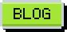</picture></a>
<a href="https://mirazulislamnahid.com/resume"><picture><source media="(prefers-color-scheme: dark)" srcset="assets/dark/btn-resume.svg"><source media="(prefers-color-scheme: light)" srcset="assets/light/btn-resume.svg"></picture></a>
<a href="https://linkedin.com/in/therealnightmare/"><picture><source media="(prefers-color-scheme: dark)" srcset="assets/dark/btn-linkedin.svg"><source media="(prefers-color-scheme: light)" srcset="assets/light/btn-linkedin.svg">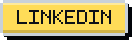</picture></a>
<a href="https://x.com/nightMARE496"><picture><source media="(prefers-color-scheme: dark)" srcset="assets/dark/btn-x.svg"><source media="(prefers-color-scheme: light)" srcset="assets/light/btn-x.svg">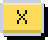</picture></a>
<a href="mailto:nnahid929@gmail.com"><picture><source media="(prefers-color-scheme: dark)" srcset="assets/dark/btn-email.svg"><source media="(prefers-color-scheme: light)" srcset="assets/light/btn-email.svg"></picture></a>

<picture><source media="(prefers-color-scheme: dark)" srcset="assets/dark/rule.svg"><source media="(prefers-color-scheme: light)" srcset="assets/light/rule.svg">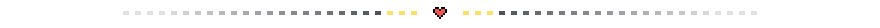</picture>

<picture><source media="(prefers-color-scheme: dark)" srcset="assets/dark/about.svg"><source media="(prefers-color-scheme: light)" srcset="assets/light/about.svg"></picture>

<picture><source media="(prefers-color-scheme: dark)" srcset="assets/dark/journey.svg"><source media="(prefers-color-scheme: light)" srcset="assets/light/journey.svg">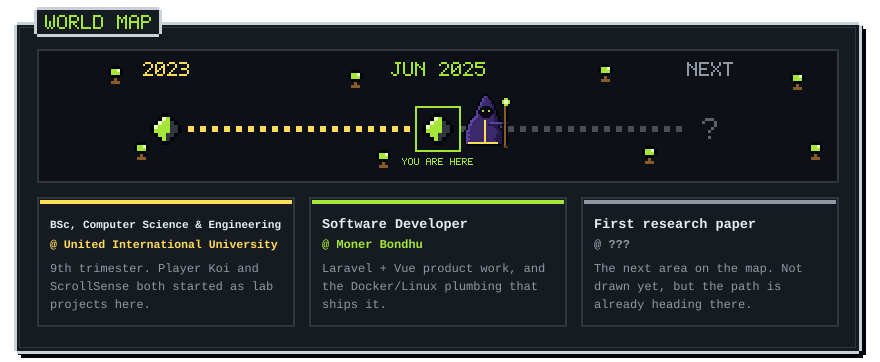</picture>

<picture><source media="(prefers-color-scheme: dark)" srcset="assets/dark/now.svg"><source media="(prefers-color-scheme: light)" srcset="assets/light/now.svg">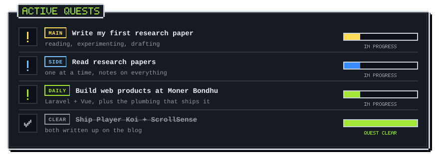</picture>

<picture><source media="(prefers-color-scheme: dark)" srcset="assets/dark/rule.svg"><source media="(prefers-color-scheme: light)" srcset="assets/light/rule.svg"></picture>

<picture><source media="(prefers-color-scheme: dark)" srcset="assets/dark/skills.svg"><source media="(prefers-color-scheme: light)" srcset="assets/light/skills.svg">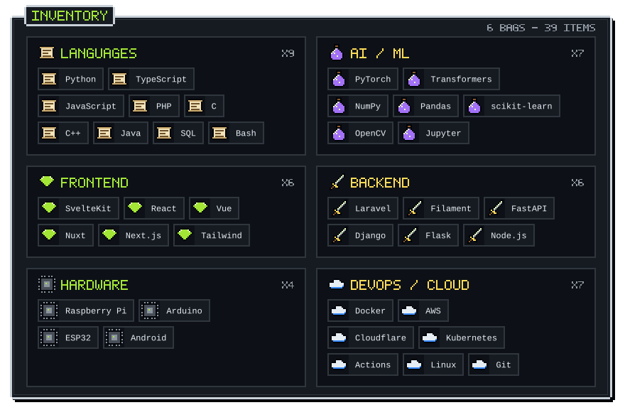</picture>

<picture><source media="(prefers-color-scheme: dark)" srcset="assets/dark/projects.svg"><source media="(prefers-color-scheme: light)" srcset="assets/light/projects.svg">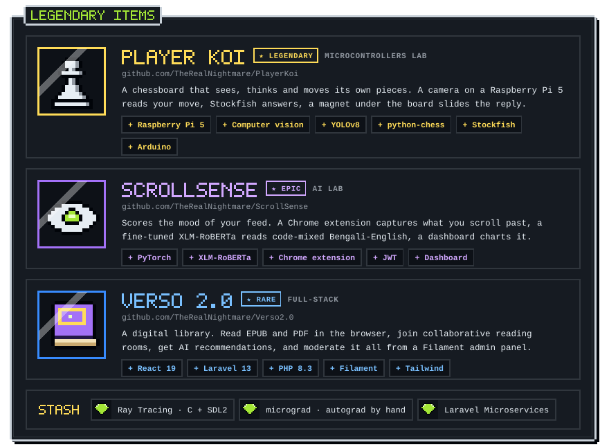</picture>

<a href="https://github.com/TheRealNightmare/PlayerKoi"><picture><source media="(prefers-color-scheme: dark)" srcset="assets/dark/btn-playerkoi.svg"><source media="(prefers-color-scheme: light)" srcset="assets/light/btn-playerkoi.svg">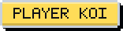</picture></a>
<a href="https://mirazulislamnahid.com/blog/player-koi-robotic-chessboard"><picture><source media="(prefers-color-scheme: dark)" srcset="assets/dark/btn-writeup.svg"><source media="(prefers-color-scheme: light)" srcset="assets/light/btn-writeup.svg">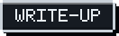</picture></a>
&nbsp;
<a href="https://github.com/TheRealNightmare/ScrollSense"><picture><source media="(prefers-color-scheme: dark)" srcset="assets/dark/btn-scrollsense.svg"><source media="(prefers-color-scheme: light)" srcset="assets/light/btn-scrollsense.svg">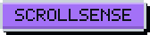</picture></a>
<a href="https://mirazulislamnahid.com/blog/scrollsense-reading-your-feeds-mood"><picture><source media="(prefers-color-scheme: dark)" srcset="assets/dark/btn-writeup.svg"><source media="(prefers-color-scheme: light)" srcset="assets/light/btn-writeup.svg"></picture></a>
&nbsp;
<a href="https://github.com/TheRealNightmare/Verso2.0"><picture><source media="(prefers-color-scheme: dark)" srcset="assets/dark/btn-verso.svg"><source media="(prefers-color-scheme: light)" srcset="assets/light/btn-verso.svg">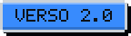</picture></a>
 
<a href="https://mirazulislamnahid.com/projects"><picture><source media="(prefers-color-scheme: dark)" srcset="assets/dark/btn-projects.svg"><source media="(prefers-color-scheme: light)" srcset="assets/light/btn-projects.svg">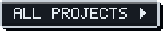</picture></a>

<picture><source media="(prefers-color-scheme: dark)" srcset="assets/dark/rule.svg"><source media="(prefers-color-scheme: light)" srcset="assets/light/rule.svg"></picture>

<picture><source media="(prefers-color-scheme: dark)" srcset="assets/dark/blog.svg"><source media="(prefers-color-scheme: light)" srcset="assets/light/blog.svg">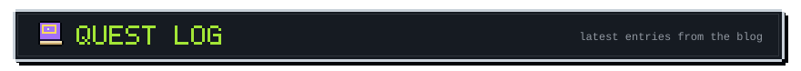</picture>

<!-- BLOG-POST-LIST:START -->
- **[Player Koi: Building a Chessboard That Sees, Thinks and Moves Its Own Pieces](https://mirazulislamnahid.com/blog/player-koi-robotic-chessboard)** — Oct 2026 · a camera above, Stockfish inside, a magnet underneath
- **[ScrollSense: Scoring the Mood of Your Facebook Feed Without Getting Banned](https://mirazulislamnahid.com/blog/scrollsense-reading-your-feeds-mood)** — Sep 2026 · fine-tuned XLM-RoBERTa on code-mixed Bengali
- **[From Localhost to Production: A CI/CD Pipeline for Nuxt.js on AWS EC2](https://mirazulislamnahid.com/blog/building-cicd-pipeline-nuxt-aws)** — Dec 2025 · GitHub Actions, S3, CodeDeploy, EC2
<!-- BLOG-POST-LIST:END -->

<a href="https://mirazulislamnahid.com/blog"><picture><source media="(prefers-color-scheme: dark)" srcset="assets/dark/btn-readmore.svg"><source media="(prefers-color-scheme: light)" srcset="assets/light/btn-readmore.svg">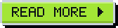</picture></a>

<picture><source media="(prefers-color-scheme: dark)" srcset="assets/dark/rule.svg"><source media="(prefers-color-scheme: light)" srcset="assets/light/rule.svg"></picture>

<picture><source media="(prefers-color-scheme: dark)" srcset="assets/dark/stats.svg"><source media="(prefers-color-scheme: light)" srcset="assets/light/stats.svg"></picture>

<picture><source media="(prefers-color-scheme: dark)" srcset="assets/dark/contact.svg"><source media="(prefers-color-scheme: light)" srcset="assets/light/contact.svg"></picture>

