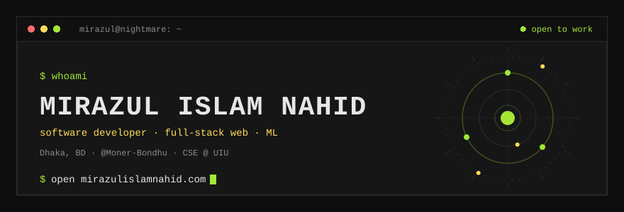
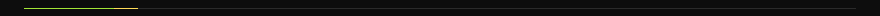
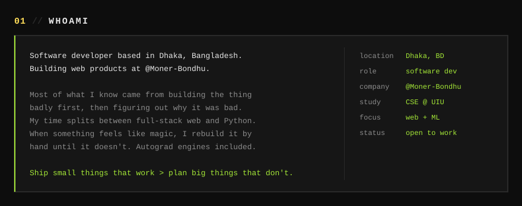
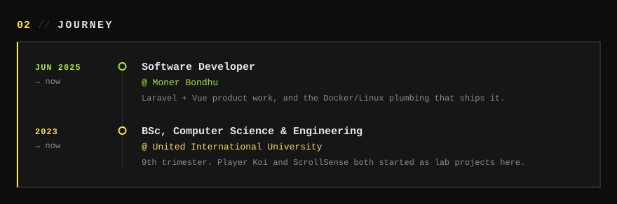
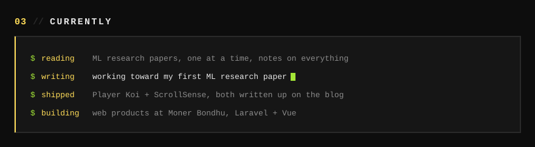
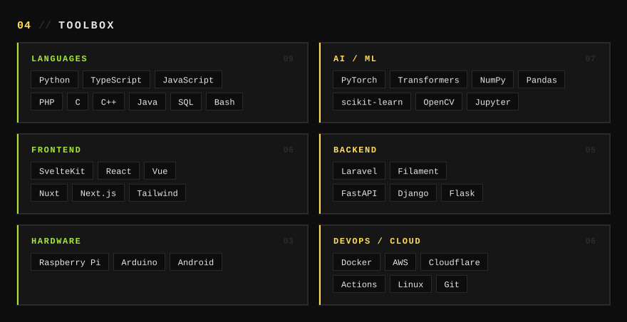
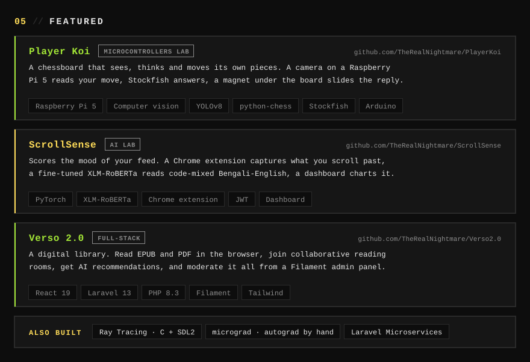
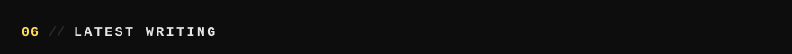
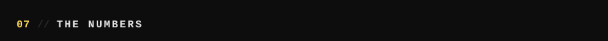
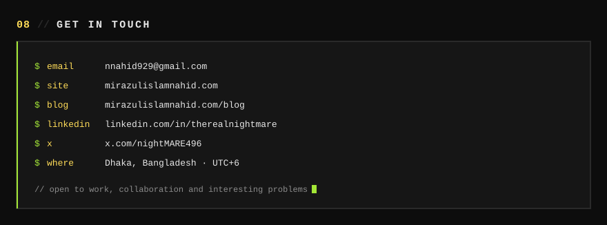

  

  
  
  
  
  
  
  

  

  

  

  

  
   
  
   
  
   
  

  

  
  
  &nbsp;
  
  
  &nbsp;
  
   
  

  

<!-- BLOG-POST-LIST:START -->
- **[Player Koi: Building a Chessboard That Sees, Thinks and Moves Its Own Pieces](https://mirazulislamnahid.com/blog/player-koi-robotic-chessboard)** — Oct 2026 · a camera above, Stockfish inside, a magnet underneath
- **[ScrollSense: Scoring the Mood of Your Facebook Feed Without Getting Banned](https://mirazulislamnahid.com/blog/scrollsense-reading-your-feeds-mood)** — Sep 2026 · fine-tuned XLM-RoBERTa on code-mixed Bengali
- **[From Localhost to Production: A CI/CD Pipeline for Nuxt.js on AWS EC2](https://mirazulislamnahid.com/blog/building-cicd-pipeline-nuxt-aws)** — Dec 2025 · GitHub Actions, S3, CodeDeploy, EC2
<!-- BLOG-POST-LIST:END -->

  

  

  
  

  

